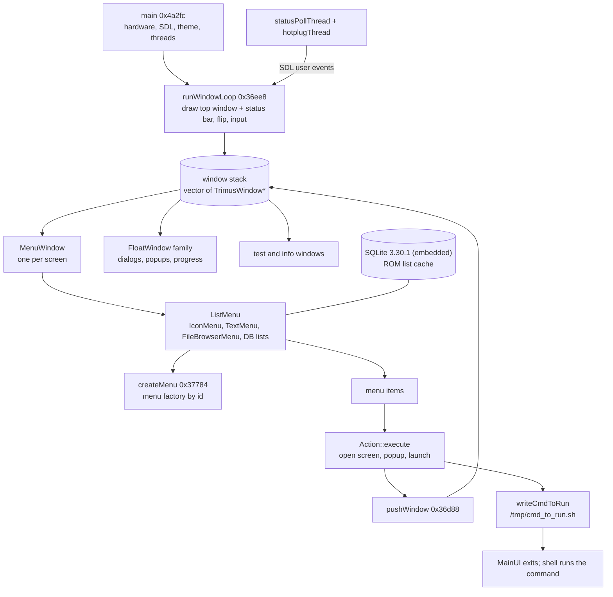

# MainUI Program Map

Miyoo Mini Plus launcher (`MainUI-354-clean`, Onion v4.4.0 beta 20260120, commit 07505ea),
reverse-engineered with Ghidra 12.1.4. MainUI is a C++ SDL 1.2 program built around a stack of
windows: `main` sets up hardware and SDL, then `runWindowLoop` draws whichever window is on top
and hands it input until the stack empties or the program is told to quit.

All addresses are for this exact binary (SHA-256 `98c85f6c…0c94`). It is not
position-independent as a whole, so its internal addresses are fixed for this build.

## At a glance



Each screen is a window on a stack. Menus are lists of items, items carry actions, and actions
either open another window or write a launch command and exit.

## What is in the binary

| Part | Address range | Functions | Size |
| --- | --- | --- | --- |
| Miyoo launcher code (22 units proven) | 0x15b20–0x51b5c and 0x11cdc8–0x150ad8 | 2,612 tracked | 458,064 bytes |
| cJSON 1.7.10, compiled as C++ (byte-exact) | 0x51b60–0x57920 | 104 | 24 KB |
| SQLite 3.30.1 (byte-exact) | 0x57920–0x11cdc8 | 2,126 | 808 KB |
| stb streaming zlib decoder (included in launcher total) | 0x1302cc–0x131e34 | 19 | 7,016 bytes |
| tiny-utf8 4.4.x (header-only `tiny_utf8::string`) | template code in the files that use it, e.g. 0x143ea4–0x1484d4 | ~100+ | |
| libgcc helpers / C startup | from 0x150ad8 / before 0x15b20 | | |

All tracked launcher code now passes whole-unit code/layout checks. Link-time words are masked;
a complete linked executable, data layout and import/relocation targets remain to be reconstructed.
The I2C authentication unit at 0x14f730–0x150ad8 uses `-fPIC`; the main UI is fixed-address code.

tiny-utf8 (github.com/DuffsDevice/tiny-utf8) is identified by its error messages and by code: under
MainUI's flags v4.4.1–v4.4.3 compile identically, and `scripts/fetch-tinyutf8.sh` pins v4.4.3. Being
header-only, it has no range of its own: its functions appear in the template tail of each file that
first uses them, and come for free once that file's source is right (see `src/tu_143720.cpp`).

Shared libraries it links against:

- **SDL 1.2** with SDL_ttf, SDL_image and SDL_mixer: drawing, fonts, PNGs, sound.
- **Miyoo libraries:** `libshmvar` (settings shared between processes: `InitKeyShm`/`GetKeyShm`/`SetKeyShm`),
  `libgamename` (`GetGameName`, ROM display names), `librsautil` (`encrypt_path`, RSA). `librsautil`
  is used together with `MI_SYS_ReadUuid`, which suggests a device check that hasn't been traced yet.
- **SigmaStar MI libraries:** `MI_DISP_*` for LCD parameters (color, brightness) and `MI_SYS_ReadUuid`.
  Audio goes through SDL_mixer and libmad.
- **libstdc++, glibc 2.28, zlib, freetype.**

The C++ type info survives, so all 69 class names and their inheritance are exact.

## Startup: what main does

`main` at 0x4a2fc, in order:

1. Sets the CPU governor to `ondemand` and creates `/tmp/stay_awake`.
2. Loads the Wi-Fi driver `8188fu.ko` from the SD card if it isn't already loaded.
3. Sets the running flag and installs a SIGTERM handler (`onSIGTERM`) that clears it; this is how a clean shutdown ends the loop.
4. Starts the Wi-Fi monitor, then SDL (video + timer) and TTF; sets `trimui_show=yes` and picks `AUDIODEV` (`/dev/dsp` or `/dev/dsp1`).
5. Reads the battery. If the charger is plugged in and `/tmp/no_charging_ui` is absent, it marks charging mode.
6. Opens the shared settings (`InitKeyShm`) and opens audio at 48 kHz, with a 4096 or 128 sample buffer depending on setting 0xd.
7. Hides the cursor, sets key repeat to 500 ms delay / 100 ms rate, opens a **640×480×32** screen (`g_screen`) and a matching back buffer (`g_backBuffer`).
8. Loads the theme list from `/mnt/SDCARD/Themes` and the current skin; quits if the skin fails to load.
9. Sets up the framebuffer (`/dev/fb0` ioctl) and loads languages. In charging mode it runs `chargingScreenLoop`, where the power key reboots.
10. Starts `wpa_supplicant` if it isn't running.
11. Starts `statusPollThread` and `hotplugThread`.
12. Loads the pinyin table (`./py.dat`) and the Recent list (`recentlist.json`), calls `encrypter_init`, and scans the Emu, App and RApp folders under `/mnt/SDCARD`, reading each entry's `config.json`.
13. Restores audio settings and list positions (`/appconfigs/romwinidx.json`), then tries to restore the previous windows from `/tmp/state.json`; if there are none, `createRootWindow` builds the main menu.
14. Calls **`runWindowLoop`**. When it returns, it stops the threads, frees everything and calls `appExit(0)`.

## The main loop and window stack

`runWindowLoop` (0x36ee8) works on a `std::vector<TrimusWindow*>`; `g_windowStack` points at it
and the top window is `back()`. While the stack isn't empty and `g_running` is set, each pass:

1. Calls `update()` on the top window, then `animateIn()` and `draw(g_backBuffer)`.
2. Draws the status-bar indicators right to left, except on window id 0x19.
3. Calls `flipScreen()` to copy the back buffer to the screen.
4. If windows are waiting in `g_pendingWindows` (queued with `pushWindow`), moves the next one onto the stack and calls its `onShow()`.
5. Otherwise passes queued SDL events to the top window's `handleInput()` and acts on the result.

**TrimusWindow virtual slots** (call offset = slot × 4):

| Slot | Offset | Meaning | Base default |
| --- | --- | --- | --- |
| 0, 1 | 0x0, 0x4 | destructor, deleting destructor | null (abstract) |
| 2 | 0x8 | `int handleInput()` returns a result code | pure virtual |
| 3 | 0xc | `draw(SDL_Surface*)` | pure virtual |
| 4 | 0x10 | `onHide()` before the window is deleted | pure virtual |
| 5 | 0x14 | `onShow()` when it becomes active | pure virtual |
| 6 | 0x18 | `saveState(cJSON*)`, called by `saveWindowState` | pure virtual |
| 7 | 0x1c | `restoreState(cJSON*)`, called by `restoreWindowState` | pure virtual |
| 8 | 0x20 | `update()` each frame, before draw | pure virtual |
| 9, 10 | 0x24, 0x28 | `animateIn` / `animateOut(SDL_Surface*, flipFn)` | empty |

`draw` and `restoreState` return `int`, as confirmed by ImeWindow's whole-unit match and the
MenuWindow decompilation. The shared headers reflect those return types.

**handleInput result codes:**

| Code | Effect |
| --- | --- |
| -1 | nothing; keep looping |
| 1 | close this window, if it isn't the last one |
| 4 | close this window |
| 3 | close this window if its id is negative, then leave the loop |
| 2 | leave the loop (quit) |

On exit the loop deletes `/tmp/cmd_to_run.sh` if the last code was 1, saves the open windows to
`/tmp/state.json` and the list positions to `/appconfigs/romwinidx.json`.

## Window classes: exact layout

`src/TrimusWindow.h` and `src/MenuWindow.h` declare both classes with the exact virtual order
and member offsets, proven by byte-exact rewrites (see `src/MATCHES.md`).

**TrimusWindow (12 bytes):** vtable at +0, `titleLabelId` at +0x4 (the title's language-string
ID; the Wi-Fi window uses 0x83, the same ID as the Wi-Fi settings item), `id` at +0x8 (the
window/menu ID).

**MenuWindow (0x11c bytes):**

| Offset | Member | Notes |
| --- | --- | --- |
| 0x0c | `ListMenu *menu` | built in `onShow`; not freed by the window |
| 0x10–0x18 | `savedCurPos`, `savedPageStart`, `savedPageEnd` | restored into the list; saved as `currpos`/`pagestart`/`pageend` |
| 0x1c, 0x1d | two flags | 0x1d is set in `onShow` |
| 0x20, 0x3c, 0x98, 0x100 | `std::string` | purpose not traced yet |
| 0x38 | int | 0 at construction |
| 0x54 | bool | true at construction |
| 0x58 | `SDL_Surface*` | freed in destructor |
| 0x5c | emulator / RetroArch app entry | ROM lists (ids 5, 0x11); saved as `emuname`/`raname` |
| 0x60 | 32-byte helper (`MenuHelper60`) | constructed with 2 |
| 0x80 | 0x14-byte keyed cache (`MenuHelper80`, see src/MenuHelpers.h) | new entries and hits move to the front; evicts from back; free callback; +0x94 untouched |
| 0xb0 | `SDL_Surface *iconTF` | `skin/icon-TF.png` |
| 0xb4 | `std::string` | used when building ROM lists |
| 0xcc | `std::string path` | folder passed to `createMenu`; saved as `ppath` |
| 0xe4 | `std::string themePath` | copy of `g_themePath` |
| 0xfc | `SDL_Surface*` | freed only if the flag at 0x118 is set |

Because the layout and vtable order are exact, your own C++ classes deriving from `TrimusWindow`,
built with the same toolchain, are binary-compatible and can be handed to `pushWindow` (0x36d88).

## Classes and menus

69 classes in five families:

| Family (base) | Members | Role |
| --- | --- | --- |
| **TrimusWindow** | MenuWindow; FloatWindow → DialogWindow, PopUpWindow, ProgressDialog, NotifyWindow → CountDownWindow; GameDetailWindow, ImeWindow, KeySettingWindow; test windows (KeyTest, KeyTest2, SDLKeyTest, LCDTest, SoundTest, SDCardTest, ADCInfo) | Everything on the window stack |
| **ListMenu** | IconMenu, FileBrowserMenu; TextMenuDrawer → TextMenu → SettingMenu, ThemeMenu, LanguageMenu, ColorMenu, DeviceInfoMenu, HardwareTestMenu; DBCachedTextMenu, MultiDBCachedTextMenu; WifiMenuDrawer → WifiMenu, HotspotMenu | The list inside a MenuWindow (+0x0c current item, +0x10 page start, +0x14 page end) |
| **Action** (slot 2 = `execute`) | AppAction, EmuAction, FileAction, GeneralAction, SearchAction, GlobalSearchAction, Popup*Action, Wifi*Action, Hotspot*Action; MenuAction → Delete/ClearRecent/ClearFavorite; MenuItemAction → Add/RemoveFavorite | What an item does when chosen |
| **ItemDrawable** | WifiItem, WifiLabel, WifiOnOffLabel, Hotspot*Item | Custom-drawn rows |
| **BGWorker** | LoadSurfaceWorker, DBCacheWorker | Background loading |

**How a screen opens:** `IconMenu::onSelect` (0x27724) reads the chosen item and builds a new
`MenuWindow` for `item->menuId` (+0x4c), calls `onShow()` and pushes it onto the stack.
`MenuWindow::onShow` (0x2f290) builds its list lazily: menu 0x18 is global search, menus 5 and
0x11 are ROM lists from the SQLite cache, and everything else goes through
**`createMenu(menuId, path)`** at 0x37784.

The Wi-Fi/Hotspot unit is proven at 0x138c50–0x13edfc. `ListMenu` is a 0x48-byte base;
`WifiMenuDrawer` extends it to 0x5c bytes with an item-pointer vector at +0x48, highlight surface
at +0x54, and row height at +0x58. `WifiMenu` is 0x22fc bytes, including 32 scan records of 0x114
bytes each. The legacy `getWifiConnected`/`setWifiConnected` names in `tu_14b860.c`
(0x14bc54/0x14bc78) refer to the hotspot/AP-mode flag, rather than station connection status.

The key-mapping screen is proven at 0x1376fc–0x138c50. `KeySettingWindow` (id 0x19)
is 0x15c bytes: three surface pointers at +0x0c, selected index at +0x18, eight `std::string`
key names at +0x1c, eight SDL rectangles at +0xdc, and a 64-byte keymap at +0x11c. It captures
SDL key releases; MENU (Escape) serializes the mapping, saves system settings, and closes. The file also
contains a touch worker that reads `/dev/input/event0` and pushes directional user events; nothing
in this build starts it. Commented source: `src/tu_1376fc.cpp`; the keymap itself is applied by
`setupKeymap` in `src/tu_14b860.c`.

**createMenu IDs:**

| ID | Builds | ID | Builds |
| --- | --- | --- | --- |
| 0 | main menu (IconMenu) | 9 | DeviceInfoMenu |
| 1 | Games: emulator icons (IconMenu) | 10 | Recent list |
| 2 | Favourites (`/mnt/SDCARD/Roms/favourite.json`) | 0xb | HardwareTestMenu |
| 3 | Apps | 0xe | LanguageMenu |
| 4 | file browser (FileBrowserMenu on SD / P2EXT) | 0x12 | ColorMenu |
| 7 | WIN_SETTING (SettingMenu) | 0x13 | ThemeMenu |
| 0x10 | IconMenu variant | 0x14 | WIN_FIXES (SettingMenu) |

**Main menu items** are `IconMenuItem(labelId, iconFocused, iconNormal, background, backgroundSelected, menuId, param, flag)`,
added in this order: Recent (→ 10), Favourites (→ 2), Games (→ 1), RetroArch, Apps (→ 3),
Settings (→ 7). Icons come from the theme's `skin/ic-*-f.png` / `ic-*-n.png`.

**Rows and selection.** TextMenu, IconMenu and FileBrowserCache use the same raw-pointer vector
specialization. A TextItem (0x74 bytes) owns its Action only when flag1c is true; its +0x20 value
is an SDL surface, not an integer setting. Accepting a text row runs Action::execute; ordinary
icons directly open their MenuWindow. Global-search icon id 24 instead prepares the ROM caches
and opens ImeWindow with GlobalSearchAction. SearchAction opens a search MenuWindow after IME
acceptance. EmuAction distinguishes ROM launches from folders; AppAction builds app commands.
The progress method receives the current integer index and can open GameDetailWindow.

MenuWindow's secondary popup borrows launch Actions (ownership flag false), and creates owned
AddFavorite/DeleteRom/Search Actions for ROM rows, RemoveFavorite/ClearFavorite Actions for
favourites, and ClearRecent for recent rows. Destructive choices are wrapped in PopupDialogAction.
PopupProgressAction opens ProgressDialog, whose worker executes the supplied Action.

The icon item's +8/+12 fields are borrowed background surfaces, rather than coordinates.
They share the theme resources g_gameFocused/g_gameNormal/g_raRow. The reconstructed initial
storage and default-language table are recorded in `src/data.tsv`; see `docs/data-recovery.md`.

**Settings items** are a separate 0x24-byte record. The field at +8 is an integer selector,
not an Action pointer or function pointer. SettingMenu uses its own input, drawing and freeing
methods on these inherited TextMenu rows. Accept (keys 1/4) calls select; left/right adjusts
values. Newly opened windows receive onShow and are pushed directly onto the window stack.

| Selector | Behavior |
| --- | --- |
| 0 | KeySettingWindow |
| 1 / 2 / 3 | Left/right: volume 0–20, music/effects volume 0–20, backlight 1–10 |
| 4 / 5 | Confirmation → PopupProgressAction → GeneralAction: reset emulator databases/configs / reset system settings |
| 7 / 8 / 9 | Device-info menu 9 / KeyTestWindow2 / ADCInfoWindow 12 |
| 11 / 13 / 15 / 16 | Language / colour / theme / fixes menus (14 / 18 / 19 / 20) |
| 12 | Left/right cycle idle setting 0 → 5 → 15 → 30 → 0 |
| 17 | Toggle audio-server flag and `/tmp/no_audioserver` |
| 18 | Shutdown confirmation with GeneralAction(powerOff) |
| 19 / 20 | Wi-Fi / hotspot menus (21 / 23) |

Volume preview is delayed 150 ms; changing volume cancels the preceding timer/channel. The
settings destructor saves system.json, clears the dirty flag and restores volume. Colour rows
use selectors 1–4 for shared-memory keys 8–11; themes switch skins, and language rows select
filename/name pairs from the by-value language-choice vector.

**Disabled factory entries.** This Clean binary allocates these six objects and prepares their
arguments, but both the constructor and append calls are literal `mov r0,r0` NOPs. They remain
unconstructed and unlisted; the matching source preserves all twelve sites and leaked allocations.

| Item | Label ID | Menu/selector | NOP addresses |
| --- | --- | --- | --- |
| RetroArch | 0 | menu 16 | 0x37994, 0x379a0 |
| Key settings | 22 | selector 0 | 0x381d0, 0x381dc |
| Theme (when themes exist) | 125 | selector 15 | 0x38268, 0x38274 |
| Fixes | 130 | selector 16 | 0x382e4, 0x382f0 |
| Factory reset | 28 | selector 5 | 0x3831c, 0x38328 |
| Key test | 31 | selector 8 | 0x3838c, 0x38398 |

**Clean vs Expert:** exactly two instructions in `createMenu` differ, at 0x37994 and 0x379a0.
Clean replaces the RetroArch item's constructor call and its add-to-menu call with NOPs
(`e1a00000`), hiding the RetroArch icon. Nothing else differs.

The language unit is proven at 0x134080–0x1376fc. `loadLanguages` reads `./lang/` relative
to its supplied root, builds an English fallback from 156 built-in strings, and inserts other
languages in filename order. `languageString(id)` uses the configured language when available,
then the built-in string; negative IDs return an empty string and IDs ≥156 return `wrongbeef`.
Language choices are restricted to English when neither font path exists. `.short` files under
`/customer/app/lang` contain IDs 88–155. `Language.h` records the 60-byte language and 48-byte
menu-choice layouts.

The cache/worker unit is proven at 0x131e34–0x134080. `MenuHelper80` contains a 12-byte
`std::list<CacheEntry>`, free callback at +0x0c, and mutex at +0x10. Entries contain a string key
and pointer value. Hits move to the back; insertion removes entries from the back while the
existing count exceeds 1,000. `MenuHelper60` contains a pending-work limit, mutex, condition,
12-byte worker list, one SDL thread, and running flag. It inserts and takes work at the front,
and drops the oldest pending work from the back when the limit is reached. `BGWorker` slots
2 and 3 are run and completion callbacks; the worker is deleted afterward.

The custom streaming zlib decoder is proven at 0x1302cc–0x131e34. Its state is 0x100c bytes,
including two 0x7e4-byte Huffman tables, plus a separately allocated 32 KB history ring. It can
read memory or a `FILE*`; input/output bytes have different signed types under the proven flags.

The file-browser helper is proven at 0x12ce28–0x1302cc. `FileBrowserCache` is 0x1c bytes:
a path-stack vector at +0, cached-directory vector at +0x0c, and Boolean filter callback at +0x18.
Each cached directory is a string path plus a pointer to a `vector<void*>` of TextItem rows
(28 bytes for the directory record).
Loads stop at 20,000 items; navigation reuses cached vectors and moves hits to the front. Old
vectors are removed from the back when cached items exceed 40,000 before loading another
directory. Recursive counts include a nonempty subdirectory as an extra entry. `FileAction`
is 0x24 bytes: the base action, path string at +8, and operation kind at +0x20 (0x65 file,
0x66 directory). Its base result remains -1.

The theme loader is proven at 0x129f9c–0x12ce28. `Theme` is 0x18c bytes, including the
name/root, separate English and multilingual font paths, font sizes, and aligned four-byte
colors. `openThemeFont` accepts an absolute override or appends a relative path to the theme
root, then retries the built-in file under `./`. `changeLanguageFonts` selects fonts based on
font availability and the configured language. `loadTheme` loads five fonts, theme images,
21 volume icons, two WAV effects and MP3 background music; it converts/composites image
surfaces and preserves the per-resource fallback paths. `freeTheme` frees those resources in
the original order without clearing the globals.

## Threads, events and launching

- **statusPollThread** (0x4a050) wakes every second, polls shared settings and battery/Wi-Fi
  state, and pushes **SDL user events** the window loop picks up. `pollVolume_pushEvent` also
  writes volume changes back to shared memory.
- **hotplugThread** (0x4a170) pushes an SDL event on device hotplug.
- **Wi-Fi monitor** (`startWifiMonitor`, a pthread) runs `wifiStatusCallback` for udhcpc and wpa_supplicant.
- **handleGlobalInput** (0x17744) is the shared key handler: it turns SDL key events into MainUI's button
  codes, plays key sounds, handles the power key and passes MainUI's own user events through. The
  button, key and event codes are named in `src/Input.h` (original names from `keyEventName`), the
  shared-memory settings in `src/ShmVar.h`; the commented function is in `src/tu_015b20/p01.inc`.

**Launching a game or app** doesn't happen inside MainUI. `AppAction::execute` calls
`launchApp_buildCommand` (0x18560), which builds
`cd <dir>; chmod a+x <launch>; LD_PRELOAD=…/libpadsp.so <launch> <args>`. `writeCmdToRun` (0x17fc0)
writes it to **`/tmp/cmd_to_run.sh`** and the loop exits. Onion's runtime script runs the command
and restarts MainUI, which restores its windows from `/tmp/state.json`.

## Files and state

| Path | Use |
| --- | --- |
| `/mnt/SDCARD/system.json` | System settings (Onion moved this from `/appconfigs`) |
| `/appconfigs/romwinidx.json` | Selected item and scroll position for each list |
| `/tmp/state.json` | Open windows, saved on exit and restored on start |
| `/tmp/cmd_to_run.sh` | Command to run after MainUI exits |
| `/mnt/SDCARD/Roms/favourite.json`, `recentlist.json` | Favourites and recent games |
| `/mnt/SDCARD/Emu`, `/App`, `/RApp` | Emulator, app and RetroArch-app folders scanned at startup |
| `/mnt/SDCARD/Roms/<SYS>/`, `/mnt/SDCARD/Imgs/<SYS>/` | ROMs and box art |
| `/mnt/SDCARD/Themes`, `skin/*.png` | Themes and skin images |
| `/customer/app/lang`, `/mnt/SDCARD/miyoo354/app/lang` | Language strings |
| `./py.dat` | Pinyin table for search |
| `/tmp/stay_awake`, `/tmp/no_charging_ui`, `/tmp/battery_charging`, `/tmp/no_audioserver`, `/tmp/audioserver_restart` | Flag files shared with other system processes |
| `/tmp/wpa_status.txt`, `/tmp/wpa_scan.txt`, `/appconfigs/wpa_supplicant.conf` | Wi-Fi |
| Shared memory (`g_keyShm`) | Live settings such as volume and brightness, via libshmvar |

## Where to add your own features

**Two ways to hook:**

1. **An `LD_PRELOAD` library (recommended).** Build a small `.so` with the same toolchain and
   start MainUI with `LD_PRELOAD`. It can wrap any imported function directly (`SDL_PollEvent`,
   `SDL_UpperBlit`, `fopen`, `system`, …). For internal functions, a constructor in the library
   patches a jump at the function's fixed address. Nothing on disk changes.
2. **Byte patches,** as Onion does for small changes (the two NOPs of Clean mode). Fine for
   flipping behavior, limited by available space.

| Goal | Where | Notes |
| --- | --- | --- |
| Global hotkeys | wrap `SDL_PollEvent` / `SDL_PeepEvents` | All window input passes through these |
| Change how games launch | wrap `fopen`/`fputs` on `/tmp/cmd_to_run.sh`, or edit Onion's runtime script | No reverse engineering needed |
| Overlay or new status-bar icon | after the indicator calls in `runWindowLoop`, before `flipScreen` (0x36c20) | Draw onto `g_backBuffer` (0x181928, 640×480 ARGB) |
| React to settings changes | `statusPollThread` (0x4a050) or `GetKeyShm`/`SetKeyShm` | Settings live in shared memory |
| Add a main-menu icon | `createMenu` case 0 (0x37784) | Add an `IconMenuItem` pointing at a new menu id |
| Add a Settings entry | `createMenu` case 7 (`SettingMenuItem`, 0x282d0) | Use an integer selector handled by SettingMenu::select (table above) |
| A whole new screen | your own `TrimusWindow` subclass + `pushWindow` (0x36d88) | Layout is exact; subclass in C++ with the same toolchain |

## Exact toolchain and compiler flags

```
arm-linux-gnueabihf-g++ -O0 -fsigned-char      # Arm GNU Toolchain 8.2-2018.08 (arm-rel-8.23)
```

- **The toolchain** is Arm's original package (SHA-256 `5b3f20e1…b439b9`, matching Arm's published
  checksum); its version stamp is identical to MainUI's `.comment` section.
- **The flags** come from rebuilding the embedded SQLite 3.30.1 (its source ID
  `2019-10-10 20:19:45 18db032d…` matches; recorded options are only `COMPILER=gcc-8.2.1` and
  `THREADSAFE=1`). `-O1/-O2/-O3/-Os` match zero functions. `-O0` matches about half; the rest
  differ because the original loads `char` as signed (`ldrsb`). With `-O0 -fsigned-char`, all
  2,126 functions and 808,104 bytes are identical at 0x57920.
- **cJSON 1.7.10** matches only when compiled as C++: all 104 functions, 23,996 bytes at 0x51b60.
- **Miyoo's own C++** matches with the same flags (see `src/MATCHES.md`); the final C authentication unit additionally requires `-fPIC`.

## Open questions

- The `librsautil` + UUID device check
- What each status-bar indicator draws
- The MenuWindow strings whose purpose isn't traced yet
