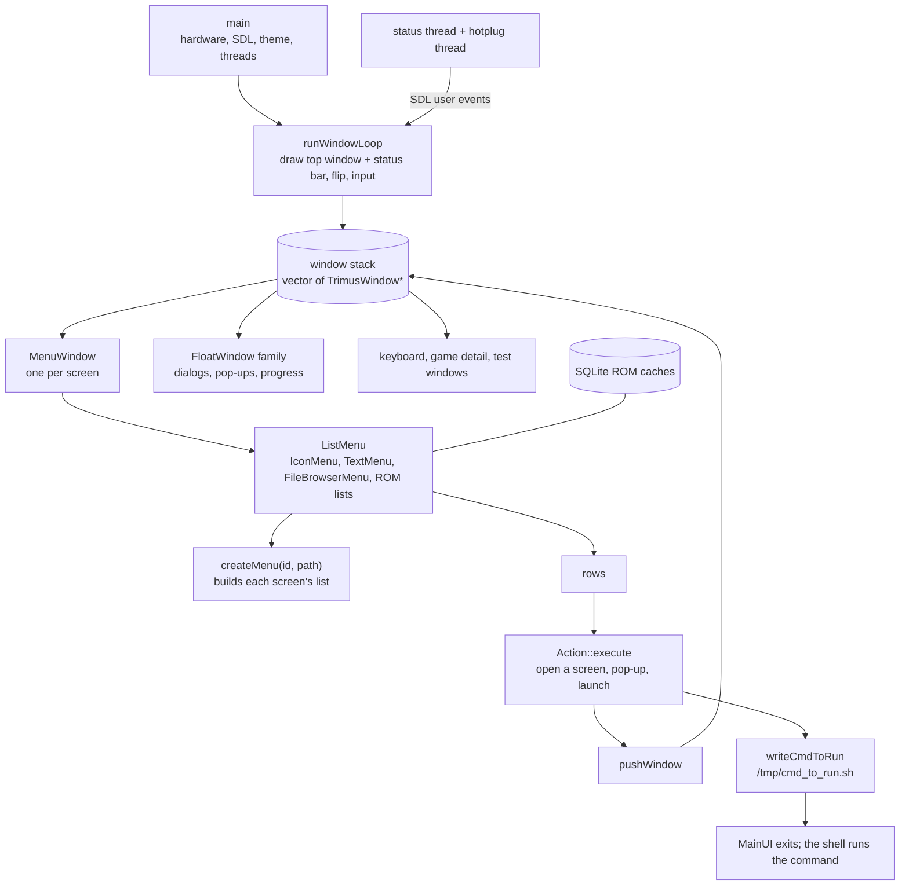

# Source guide

How MainUI works, and where each part of it lives in `src/`. Read this before diving into a file.
For what MainUI does from the outside (file formats, launch commands, timings), see
[behavior.md](behavior.md).

## The program in one picture

MainUI is a C++ program on SDL 1.2. Every screen is a **window** on a stack. Most windows are a
`MenuWindow` holding a **list** (`ListMenu`). A list's rows carry **actions**, and an action
either opens another window or writes a launch command and exits. MainUI never runs games
itself: Onion's shell script runs the command and then starts MainUI again, which reopens the
same screens from `/tmp/state.json`.

## How the source is organized

The original program was built from 22 separate source files (translation units), and `src/` has
one file for each. The original file names aren't recorded in the binary, so each file is named
after what it contains. Its first comment line gives the address range it covers, and
[tu-map.tsv](tu-map.tsv) lists all the ranges. Functions appear **in the original address
order**.

| File | Contents |
| --- | --- |
| [MainUI.cpp](../src/MainUI.cpp) | The main user interface, about 1,100 functions in one file (as in the original). Lines of `=` mark its sections: text drawing, the status bar, global input and launching; list actions and busy screens; favorites, Recent and app lists; list navigation and drawing; the ROM cache databases; icon menus and settings rows; the Settings and Device Info menus; color, language, theme and file-browser menus; `MenuWindow` and `FloatWindow`; pop-ups, dialogs and the game detail window; the window loop, `createMenu` and the charging screen. |
| [Main.cpp](../src/Main.cpp) | `main` and the status and hotplug threads |
| [RingList.cpp](../src/RingList.cpp) | a small circular linked list |
| [HardwareTests.cpp](../src/HardwareTests.cpp) | factory hardware tests (keys, LCD, sound, SD card) |
| [Config.cpp](../src/Config.cpp) | reading Emu/App/RApp/Themes `config.json` folders, the Recent list, device and SD card helpers, image loading |
| [Theme.cpp](../src/Theme.cpp) | loading a theme: fonts, images, colors, sounds |
| [FileBrowser.cpp](../src/FileBrowser.cpp) | reading folders for the file browser |
| [ZlibDecoder.cpp](../src/ZlibDecoder.cpp) | a DEFLATE (zlib) decoder adapted from stb_image |
| [MenuHelpers.cpp](../src/MenuHelpers.cpp) | `LruCache` and `WorkerQueue` (thumbnail loading) |
| [Language.cpp](../src/Language.cpp) | user-interface languages |
| [KeySettingWindow.cpp](../src/KeySettingWindow.cpp) | the button-mapping screen |
| [WifiMenus.cpp](../src/WifiMenus.cpp) | the Wi-Fi and hotspot screens |
| [ImeWindow.cpp](../src/ImeWindow.cpp) | the on-screen keyboard (`ImeWindow`) |
| [Pinyin.cpp](../src/Pinyin.cpp) | the pinyin table for ROM search |
| [GlobalSearch.cpp](../src/GlobalSearch.cpp) | global ROM search across all emulators |
| [Device.c](../src/Device.c) | battery, backlight, volume, audio hotplug (C) |
| [Settings.c](../src/Settings.c) | `system.json` settings and the keymap (C) |
| [ZipReader.c](../src/ZipReader.c) | a read-only zip reader (C) |
| [BuiltinStrings.c](../src/BuiltinStrings.c) | the built-in English strings and `.short` language files (C) |
| [I2c.c](../src/I2c.c) | I2C helpers for the device check (C) |
| [Wifi.c](../src/Wifi.c) | the Wi-Fi backend: `wpa_cli`, scanning, the monitor thread (C) |
| [DeviceAuth.c](../src/DeviceAuth.c) | the device check run before anything else (C, vendor code built with GCC 7.3.0) |

### What is in the binary

| Part | Address range | Source |
| --- | --- | --- |
| C start-up code | before 0x15b20 | the toolchain |
| Miyoo's own code, part 1 | 0x15b20–0x51b5c | `src/` (main UI, main, hardware tests) |
| cJSON 1.7.10, compiled as C++ | 0x51b60–0x57920 | downloaded |
| SQLite 3.30.1 | 0x57920–0x11cdc8 | downloaded |
| Miyoo's own code, part 2 | 0x11cdc8–0x150ad8 | `src/` (helpers, theme, languages, Wi-Fi, C units) |
| libgcc helpers | from 0x150ad8 | the toolchain |

Template code from the header-only libraries (tiny-utf8, RapidXml) and from libstdc++ sits after
the functions of each file that uses it.

Not in `src/`:

- **Third-party code compiled into MainUI**, which the build downloads from the projects' own
  releases: SQLite 3.30.1, cJSON 1.7.10, and the header-only libraries tiny-utf8 4.4.3 and
  rapidxml.
- **The C start-up code**, which comes from the toolchain.

### Headers

Class layouts are exact, and each class is declared once:

- [TrimusWindow.h](../src/TrimusWindow.h), [MenuWindow.h](../src/MenuWindow.h), and the others
  in `src/`;
- [MainUI.h](../src/MainUI.h) for the classes of the main UI unit.

The numbers MainUI passes around have names:

| Header | Names |
| --- | --- |
| [Input.h](../src/Input.h) | Miyoo buttons as SDL keys, button codes, user-event codes, list results |
| [WindowIds.h](../src/WindowIds.h) | window and menu ids (`WIN_SETTING`, `WIN_ROM_LIST`, …) |
| [LangStrings.h](../src/LangStrings.h) | the 156 user-interface strings, with their English text |
| [ShmVar.h](../src/ShmVar.h) | settings shared with keymon (`MONITOR_VOLUME`, …) |
| [PlatformApi.h](../src/PlatformApi.h) | C functions shared between units; Wi-Fi states and modes |
| [TrimusWindow.h](../src/TrimusWindow.h) | what a window's `handleInput` result tells the window loop |
| [SdlApi.h](../src/SdlApi.h), [SDLTypes.h](../src/SDLTypes.h), [CJsonApi.h](../src/CJsonApi.h), [SQLiteApi.h](../src/SQLiteApi.h) | the library functions and structures MainUI uses |

### Conventions you will see

- **Address comments.** `// 0x2edac: …` before a function gives its address in the original
  binary, so you can find it in Ghidra or in a disassembly.
- **Original quirks.** Comments starting `Original quirk` or `Original bug` mark behavior kept
  exactly as the original has it. [behavior.md](behavior.md#original-quirks-and-bugs) lists them.
- **`-O0` style.** MainUI was compiled without optimization, so the machine code follows the
  source statement by statement. The source therefore keeps the original's statement order,
  redundant assignments, and occasional unused locals; "tidying" them changes the bytes.
- **Order matters.** Functions appear in address order. The include order of headers with inline
  functions decides where the compiler places template code, so includes are never sorted.
- **Binary patches.** Calls that Onion replaced by NOPs after compiling are written as small
  `asm()` blocks at the call site. Strings that Onion overwrote keep their original slot size
  (see [onion-changes.md](onion-changes.md)).
- **Explicit string pools.** Some files declare their strings as named arrays (`lit_*`) in the
  original order, where ordinary literals would be merged or reordered.
- **Globals.** `extern` declarations carry their original address (`// 0x181928`). Their initial
  values are listed in [src/data.tsv](../src/data.tsv).

## Start-up

`main` ([Main.cpp](../src/Main.cpp)) initializes the hardware and SDL, loads settings,
theme and languages, scans the Emu, App and RApp folders, restores the previous windows (or
builds the main menu), and runs `runWindowLoop`. [behavior.md](behavior.md#start-up-and-exit)
gives the exact order.

## The window loop

`runWindowLoop` ([MainUI.cpp](../src/MainUI.cpp)) works on a `std::vector<TrimusWindow*>`;
the top window is `back()`. While the stack isn't empty and the running flag is set, each pass:

1. calls `update()`, `animateIn()` and `draw(g_backBuffer)` on the top window;
2. draws the status-bar indicators right to left, except on the button-mapping screen;
3. copies the back buffer to the screen;
4. if a window was queued with `pushWindow`, moves it onto the stack and calls its `onShow()`;
   otherwise passes input to the top window's `handleInput()` and acts on the result.

| `handleInput` result | Effect |
| --- | --- |
| -1 | nothing; keep looping |
| `WINDOW_CLOSE` (1) | close this window, if it isn't the last one |
| `WINDOW_QUIT` (2) | leave the loop |
| `WINDOW_LAUNCH` (3) | close this window if its id is negative, then leave the loop (a launch command is waiting) |
| `WINDOW_FORCE_CLOSE` (4) | close this window |

### TrimusWindow

`TrimusWindow` ([TrimusWindow.h](../src/TrimusWindow.h)) is the 12-byte base of every window:
vtable, `titleLabelId` (a language string id), `id` (a [window id](../src/WindowIds.h)). Its
virtual functions are, in vtable order:

1. the destructors;
2. `handleInput`, `draw`, `onHide` and `onShow`;
3. `saveState` and `restoreState`, which read and write `/tmp/state.json`;
4. `update`;
5. `animateIn` and `animateOut`.

## Classes

The C++ type information survives in the binary, so all 69 class names and their inheritance are
the original ones.

| Family (base) | Members | Role |
| --- | --- | --- |
| **TrimusWindow** | MenuWindow; FloatWindow → DialogWindow, PopUpWindow, ProgressDialog, NotifyWindow → CountDownWindow; GameDetailWindow, ImeWindow, KeySettingWindow; test windows (KeyTest, KeyTest2, SDLKeyTest, LCDTest, SoundTest, SDCardTest, ADCInfo) | Everything on the window stack |
| **ListMenu** | IconMenu, FileBrowserMenu; TextMenuDrawer → TextMenu → SettingMenu, ThemeMenu, LanguageMenu, ColorMenu, DeviceInfoMenu, HardwareTestMenu; DBCachedTextMenu, MultiDBCachedTextMenu; WifiMenuDrawer → WifiMenu, HotspotMenu | The list inside a MenuWindow |
| **Action** (`execute`, `progress`, `finished`) | AppAction, EmuAction, FileAction, GeneralAction, SearchAction, GlobalSearchAction, Popup*Action, Wifi*Action, Hotspot*Action; MenuAction → Delete/ClearRecent/ClearFavorite; MenuItemAction → Add/RemoveFavorite | What a row does when chosen |
| **ItemDrawable** | WifiItem, WifiLabel, WifiOnOffLabel, Hotspot*Item | Custom-drawn rows |
| **BGWorker** | LoadSurfaceWorker, DBCacheWorker | Background loading |

### Screens and lists

**`MenuWindow`** ([MenuWindow.h](../src/MenuWindow.h), [MainUI.cpp](../src/MainUI.cpp), 0x11c
bytes) holds one list (`menu`), the saved list position, a thumbnail loader and cache for game
previews, and the folder path for ROM lists. `onShow` builds the list lazily:

- the global search window (24) builds a `MultiDBCachedTextMenu`;
- ROM lists (5 and 17) build a `DBCachedTextMenu` on the emulator's SQLite cache;
- every other window calls **`createMenu(id, path)`** ([MainUI.cpp](../src/MainUI.cpp)).

| id | createMenu builds | id | createMenu builds |
| --- | --- | --- | --- |
| 0 | main menu (`IconMenu`) | 9 | Device Info |
| 1 | Games: one icon per emulator | 10 | Recent |
| 2 | Favorites | 11 | Hardware Test |
| 3 | Apps | 14 | Language |
| 4 | file browser | 18 | display color |
| 7 | Settings (`SettingMenu`) | 19 | Theme |
| 16 | RetroArch apps | 20 | Fixes |

Main-menu items are `IconMenuItem`s carrying the id of the menu they open. `IconMenu::onSelect`
creates a `MenuWindow` for that id and pushes it.

**Rows.** `TextMenu`, `IconMenu` and the file browser keep their rows as raw pointers.

- A `TextItem` owns its `Action` only when `ownsAction` is set. Accepting a row runs
  `Action::execute`.
- `EmuAction` launches a ROM or opens a ROM folder; `AppAction` launches an app.
- The pop-up menu on a ROM row (`MenuWindow`'s secondary menu) offers add/remove favorite,
  delete and search. Destructive choices are wrapped in a `PopupDialogAction` confirmation.
- `PopupProgressAction` runs an action in a `ProgressDialog` with a worker thread.

**Settings rows** are `SettingMenuItem`s whose handler number (`SettingHandler` in
[MainUI.h](../src/MainUI.h)) tells `SettingMenu::select` and `handleKey` what to do:

- **Value rows** change their value with left/right.
- **Submenu rows** push a new `MenuWindow`.
- **Destructive rows** ask for confirmation first.

**Lists in other units.**

| What | Where | Notes |
| --- | --- | --- |
| Wi-Fi and hotspot screens | [WifiMenus.cpp](../src/WifiMenus.cpp) | `WifiMenu` keeps up to 32 scan results |
| Wi-Fi backend | [Wifi.c](../src/Wifi.c) | `wpa_cli` and the monitor thread |
| Button-mapping screen | [KeySettingWindow.cpp](../src/KeySettingWindow.cpp) | `KeySettingWindow` |
| Applying the keymap | `setupKeymap` in [Settings.c](../src/Settings.c) | writes the mapping to the kernel driver |
| File browser | [FileBrowser.cpp](../src/FileBrowser.cpp) | Caches up to 40,000 rows of visited folders; loads at most 20,000 items per folder |

### Background work

| Part | Where | What it does |
| --- | --- | --- |
| `WorkerQueue` | [MenuHelpers.cpp](../src/MenuHelpers.cpp) | One SDL thread that runs `BGWorker` jobs, newest first. When too much work is pending, it drops the oldest jobs. |
| `LruCache` | MenuHelpers.cpp | Keeps loaded thumbnails, at most 1,000 entries |
| `DBCacheWorker` | [MainUI.cpp](../src/MainUI.cpp) | Loads a page of ROM rows from SQLite |
| `LoadSurfaceWorker` | [MainUI.cpp](../src/MainUI.cpp) | Loads a thumbnail image |

### Threads

| Thread | Where | What it does |
| --- | --- | --- |
| Status thread | `statusPollThread`, [Main.cpp](../src/Main.cpp) | Every second, posts SDL user events when the battery, Wi-Fi state or volume indicator changes |
| Hotplug thread | Main.cpp, with the helpers in [Device.c](../src/Device.c) | Posts an event when a second sound card appears or disappears |
| Wi-Fi monitor | [Wifi.c](../src/Wifi.c) | Every 3 s; starts DHCP once connected |

`handleGlobalInput` ([MainUI.cpp](../src/MainUI.cpp)) is the single input function every
window calls. It turns SDL events into button codes and handles the power key, sounds and these
user events.

## Shared libraries MainUI links against

- **SDL 1.2**, with SDL_ttf, SDL_image and SDL_mixer: drawing, fonts, PNGs, sound.
- **Miyoo libraries:**
  - `libshmvar`: settings in shared memory, `InitKeyShm`/`GetKeyShm`/`SetKeyShm`;
  - `libgamename`: `GetGameName`, ROM display names;
  - `librsautil`: `encrypt_path`, called on each ROM path at launch.
- **SigmaStar MI libraries:** `MI_DISP_*` for the display color settings, and `MI_SYS_ReadUuid`
  for the chip id shown in Device Info.
- **libstdc++, glibc 2.28, zlib, freetype.**

## Open questions

- What `encrypt_path` (from `librsautil`, set up by `encrypter_init` in `main`) does. MainUI
  calls it on each ROM path at launch, and nothing it returns is used.
- What a few rarely used fields hold. These are commented as such in the headers.
